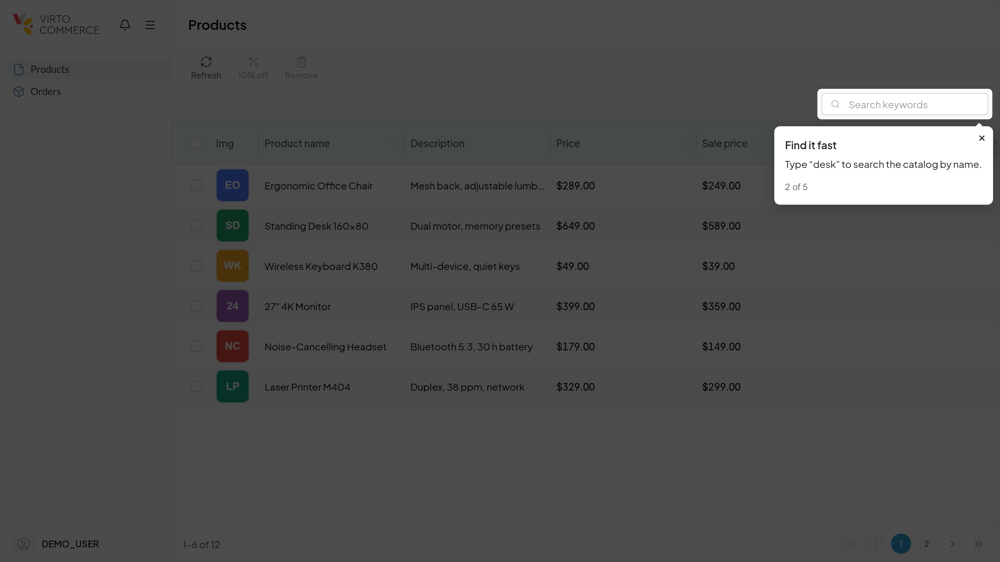
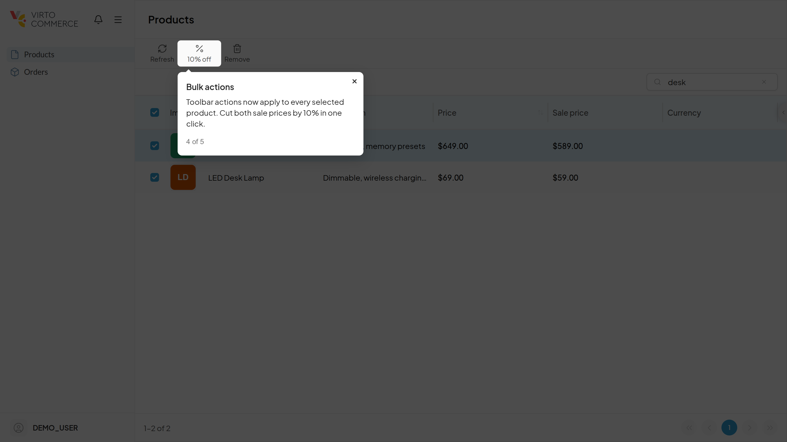

# Guided Tours Module

## Overview

The Guided Tours module shows Backoffice users a short interactive tour of a new feature the first time they open its screen in a VC-Shell app. A tour highlights parts of the interface one step at a time. A step is either a hint or an action the user performs themselves, such as searching or selecting rows; the tour continues once the action is done.

Any module can ship tours for its own features. A tour is a JSON file inside the module package, so neither the platform nor the host app has to change.





## Key Features

* Tours start on their own when their trigger holds: a blade opens, or the app starts.
* Hint steps with Next and Back, and action steps that wait until the user does what the step asks.
* Each user sees a tour version once. Finishing or closing it is remembered in the user's profile.
* Raising a tour's `version` shows the updated tour to everyone again.
* Tours are shown only to users with the listed permissions, and not to users created after the feature shipped.
* Texts in several languages; each user gets their interface language, falling back to English.
* The **Guided Tours** app lists every tour, shows its steps in plain words, switches tours on and off one by one or all at once, and launches any tour in a new tab.
* Custom tours: created in the app by pasting JSON or filling in a step form, stored in the module's database.

## How it works

A module puts tour definitions in its package at `tours/{appId}/{name}.json`, where `appId` is the VC-Shell host app the tour runs in:

```json
{
  "id": "products.bulk-actions",
  "version": 1,
  "title": { "en-US": "Bulk price change" },
  "publishedAt": "2026-11-11",
  "permissions": ["product:update"],
  "priority": 0,
  "trigger": { "bladeOpened": "ProductsList" },
  "steps": [
    {
      "title": { "en-US": "Change prices in bulk", "de-DE": "Preise gesammelt ändern" },
      "text": { "en-US": "Select products and apply a discount to all of them at once." }
    },
    {
      "target": { "css": "[data-tour='products.table'] .vc-input", "label": "search field" },
      "text": { "en-US": "Find the products you want to change." },
      "action": { "until": { "bladeQueryChanged": "ProductsList" } }
    },
    {
      "target": "products.table",
      "text": { "en-US": "Pick at least two products." },
      "action": {
        "until": { "elementAppears": { "css": "[data-tour='products.table'] input:checked" }, "atLeast": 2 }
      }
    },
    { "target": { "css": "[data-test-id='discount']", "label": "discount action" }, "text": { "en-US": "Apply the discount." } }
  ]
}
```

| Field | Meaning |
| --- | --- |
| `id`, `version` | Identity. A user who finished or closed this version never sees it again. |
| `title` | The tour's name in the Guided Tours app, per language. |
| `publishedAt` | When the feature shipped. Users whose account was created later do not get the tour. |
| `permissions` | The tour is shown only to users with any of these permissions. |
| `priority` | Tours run one at a time; higher priority goes first. |
| `trigger` | `{ "appReady": true }` or `{ "bladeOpened": "<blade name>" }`. |
| `steps[].target` | A `data-tour` anchor name, `{ "anchor": "…" }`, or `{ "css": "…" }` for markup the module does not own. The object forms take an optional `label` the app shows instead of the selector. No target: a centred hint. |
| `steps[].title`, `text` | Text per language code, such as `{ "en-US": "…", "de-DE": "…" }`. The user's interface language is used, then the same language in another region, then English, then the first text. |
| `steps[].action.until` | `bladeOpened`, `bladeQueryChanged` (table page, sort, search), `routeChanged`, `elementAppears` (with an optional `atLeast` count), or `click` on the target. |
| `steps[].action.timeout` | After this many ms the user is offered to skip the step. |
| `steps[].waitFor` | How long to wait for the target to render; a step whose target never appears is skipped. |

Anchors are `data-tour="…"` attributes in the module's blade templates. UI-kit components do not pass unknown attributes to their root element, so put the anchor on a wrapping element when the component swallows it.

A tour closes without being remembered when its trigger blade closes, and starts again the next time the blade opens.

## Configuration

### Settings

| Setting | Scope | Description |
| --- | --- | --- |
| `GuidedTours.Enabled` | Global | Shows tours. Turn off to hide every tour. |
| `GuidedTours.State` | Per user | Tour progress, read and written by the VC-Shell plugin through `/api/platform/settings/v2/me/values`. |

### Permissions

| Permission | Allows |
| --- | --- |
| `guided-tours:access` | Open the Guided Tours app, see tours, launch them. |
| `guided-tours:manage` | Create, edit, copy and delete custom tours; switch tours on and off, one or all. |

Tours themselves list the permissions of the features they describe.

## Guided Tours app

The app opens from the Apps menu (and embedded in the admin). It lists module and custom tours together:

* **Details** describe each step from its structure: hint or action, what it points at (the target's `label`, else its selector), and what an action waits for.
* **On / off** per tour, and **Show tours to users** for all of them. A tour that is off is not served to users.
* **Launch** opens the tour's app in a new tab at `/apps/{appId}/?tour={id}`, opens the trigger blade and runs the tour at once, whether it is on or off and whether the user has seen it. Nothing is recorded.
* **Copy as custom** turns a module tour into an editable custom tour, switched off.
* **Custom tours** are edited as a step form or as JSON, in every language from the `VirtoCommerce.Core.General.Languages` setting. Saving validates the format; problems are listed with their path, and a tour that is on is published at once.

If a module installed later ships a tour with a custom tour's id, the module tour wins and the custom tour is marked as conflicting until it gets another id.

## Components

### Projects

| Project | Description |
| --- | --- |
| `VirtoCommerce.GuidedTours.Core` | Settings, permissions, the tour format validator and the rules for merging, switching and serving tours. |
| `VirtoCommerce.GuidedTours.Data` | Custom tours and per-tour switches, with `Data.SqlServer`, `Data.PostgreSql` and `Data.MySql` migrations. |
| `VirtoCommerce.GuidedTours.Web` | Module entry point, tour discovery and REST API. |
| `VirtoCommerce.GuidedTours.Web/App` | The Guided Tours app (VC-Shell), built into `Content/guided-tours`. |
| `VirtoCommerce.GuidedTours.Web/ShellPlugin` | VC-Shell plugin with the tour engine, rendered with [driver.js](https://driverjs.com). Host apps load it through Module Federation; it reads its `appId` from the `plugins/{appId}/` folder it is served from. |
| `sandbox` | A VC-Shell app in demo mode with the plugin wired in directly, a sample tour and progress in localStorage. |

### REST API

| Method | Endpoint | Description |
| --- | --- | --- |
| GET | `/api/guided-tours/apps/{appId}/tours` | Module and custom tours for the host app that are on, minus tours the current user should not get. Empty when tours are off. |
| GET | `/api/guided-tours/tours?appId=` | All tours with source, module, on/off and conflict flag. `guided-tours:access`. |
| GET | `/api/guided-tours/tours/{id}` | One tour; used by launch. `guided-tours:access`. |
| POST, PUT, DELETE | `/api/guided-tours/tours`, `/tours/{id}` | Create, update (also rename) and delete custom tours. Invalid tours get `400 { problems }`. `guided-tours:manage`. |
| POST | `/api/guided-tours/tours/{id}/copy` | Copy any tour as a custom tour. `guided-tours:manage`. |
| PUT | `/api/guided-tours/tours/{id}/enabled` | Switch one tour on or off. `guided-tours:manage`. |
| POST | `/api/guided-tours/tours/validate` | Validate a tour without saving it. `guided-tours:access`. |
| GET, PUT | `/api/guided-tours/settings` | Read or switch all tours on or off. PUT needs `guided-tours:manage`. |

## Development

```bash
dotnet test VirtoCommerce.GuidedTours.sln
```

```bash
cd src/VirtoCommerce.GuidedTours.Web/ShellPlugin && yarn install && yarn test run && yarn type-check && yarn build
```

```bash
cd src/VirtoCommerce.GuidedTours.Web/App && yarn install && yarn test && yarn type-check && yarn build
```

The module does not start without the built app in `Content/guided-tours`.

```bash
cd sandbox && yarn install && yarn serve
```

The sandbox opens on <http://localhost:3310/apps/sandbox/>; sign in with any name, open **Products**, and the sample tour starts. Remove the `guided-tours-sandbox:state` localStorage key to see it again. `sandbox/demo/screenshots.mjs` retakes the README screenshots from the running sandbox.

## License

Copyright (c) Virto Solutions LTD. All rights reserved.

Licensed under the Virto Commerce Open Software License (the "License"); you
may not use this file except in compliance with the License. You may
obtain a copy of the License at

<https://virtocommerce.com/open-source-license>

Unless required by applicable law or agreed to in writing, software
distributed under the License is distributed on an "AS IS" BASIS,
WITHOUT WARRANTIES OR CONDITIONS OF ANY KIND, either express or implied.
